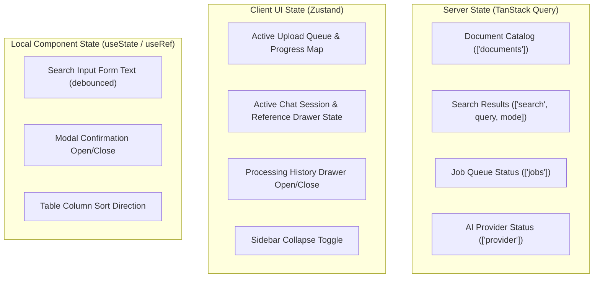
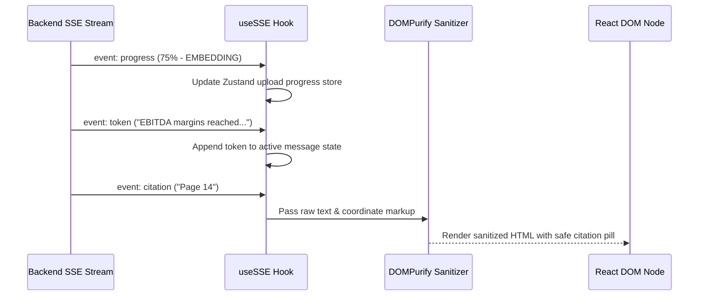

# Frontend Architecture & Component Hierarchy — DocuMind Client

> **Package**: `client/`  
> **Framework**: React 19 + TypeScript + Vite  
> **Pattern**: Feature-Sliced Architecture + Declarative State Segregation

---

## 1. Feature-Sliced Architecture Overview

The DocuMind frontend is organized by **domain features** rather than generic technical layers (such as flat "components/" or "pages/" folders):

```
client/src/
├── app/                     # Application bootstrap & providers
│   ├── App.tsx              # Root component with routing
│   ├── providers.tsx        # TanStack Query, Theme, Toast providers
│   └── routes.tsx           # Route definitions & layout wrappers
├── components/              # Shared cross-cutting components
│   ├── layout/              # Shell layout (Sidebar, Header, MainContainer)
│   └── ui/                  # shadcn/ui Radix primitives (Button, Dialog, Drawer)
├── features/                # Domain-specific feature modules
│   ├── upload/              # Drag-and-drop dropzone, multi-file queue
│   ├── documents/           # Document library table, delete modal, filters
│   ├── search/              # Search bar, mode selector, highlight cards
│   ├── chat/                # RAG chat assistant, citation badge, source drawer
│   ├── history/             # BullMQ job timeline drawer, retry trigger
│   └── settings/            # AI provider switcher & connection ping
├── hooks/                   # Shared custom React hooks (useDebounce, useSSE)
├── services/                # Network clients (Axios instance, SSE client)
├── stores/                  # Global Zustand UI stores
├── types/                   # Shared frontend TypeScript interfaces
└── main.tsx                 # Vite DOM mount point
```

---

## 2. Component Composition Hierarchy

```
┌────────────────────────────────────────────────────────┐
│                      APP LAYOUT                        │
├─────────────────┬──────────────────────────────────────┤
│ SIDEBAR         │ HEADER                               │
│ • Logo & Brand  │ • Active Route Title                 │
│ • Nav Links     │ • Global Search Trigger (Ctrl+K)     │
│   - Documents   │ • Active AI Provider Badge           │
│   - Search      │ • History Drawer Toggle Button       │
│   - Chat        ├──────────────────────────────────────┤
│   - Settings    │ MAIN VIEWPORT CONTAINER              │
│ • Storage Usage │ ┌──────────────────────────────────┐ │
│   Summary       │ │ ACTIVE ROUTE VIEW                │ │
│                 │ │ • Documents: Dropzone + Table    │ │
│                 │ │ • Search: FilterSidebar + Cards  │ │
│                 │ │ • Chat: ChatLog + CitationDrawer │ │
│                 │ └──────────────────────────────────┘ │
└─────────────────┴──────────────────────────────────────┘
```

---

## 3. State Management Segregation



### State Segregation Rules
1. **Server State strictly belongs in TanStack Query**: Never copy document lists or search results into Zustand. TanStack Query manages caching, stale times (5 minutes default), and automatic background revalidation upon SSE job completion.
2. **Client State strictly belongs in Zustand**: Upload drawer toggle states, active citation preview selections, and local UI flags belong in lightweight Zustand stores.
3. **Form & Transient State strictly belongs in `useState`**: Input field values and dropdown hover states remain local to their components.

---

## 4. Real-Time Streaming & Sanitization Pipeline


