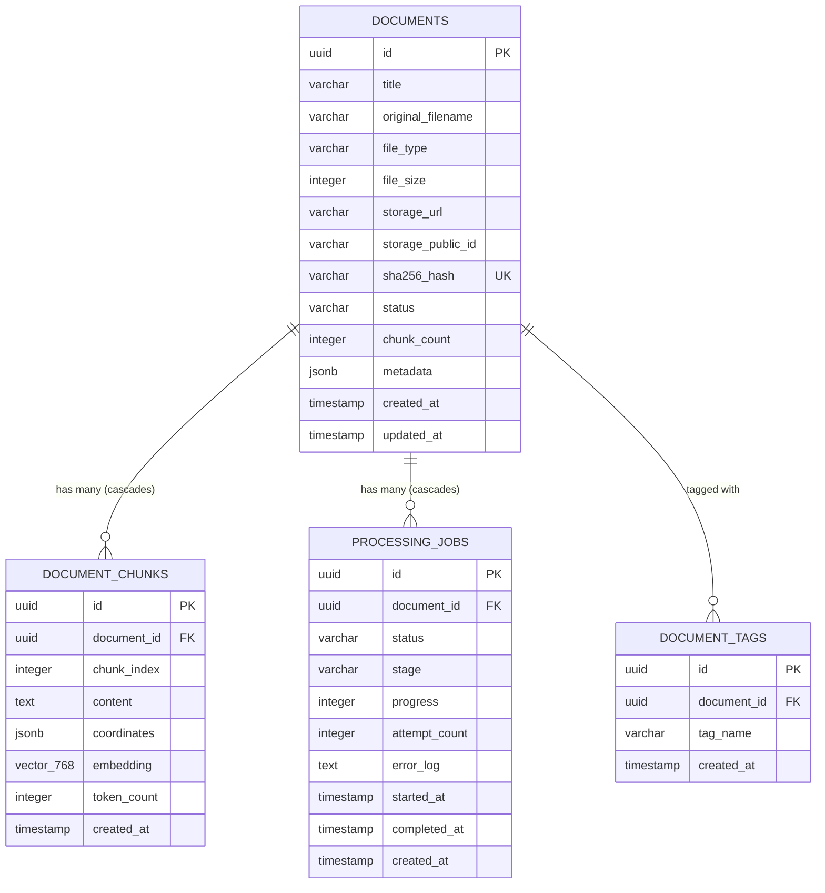

# Database Design & Schema Specification — DocuMind

> **Database Engine**: PostgreSQL 16+  
> **Extensions Required**: `pgvector` (vector cosine search), `uuid-ossp` (UUID generation)  
> **ORM Layer**: Drizzle ORM (TypeScript)

---

## 1. Entity-Relationship Diagram (ERD)



---

## 2. Table Specifications

### 2.1 `documents` Table
Stores root document metadata and upload tracking.

| Column | Data Type | Constraints | Description |
| :--- | :--- | :--- | :--- |
| `id` | `UUID` | `PRIMARY KEY`, Default `gen_random_uuid()` | Unique document identifier. |
| `title` | `VARCHAR(255)` | `NOT NULL` | Display title of document. |
| `original_filename` | `VARCHAR(255)` | `NOT NULL` | Sanitized original filename. |
| `file_type` | `VARCHAR(20)` | `NOT NULL` | Format: `'pdf'`, `'docx'`, `'xlsx'`, `'pptx'`. |
| `file_size` | `INTEGER` | `NOT NULL` | File size in bytes. |
| `storage_url` | `TEXT` | `NOT NULL` | Cloudinary raw secure download URL. |
| `storage_public_id` | `VARCHAR(255)` | `NOT NULL` | Cloudinary public ID for deletion. |
| `sha256_hash` | `CHAR(64)` | `UNIQUE`, `NOT NULL` | Binary hash for cryptographic deduplication. |
| `status` | `VARCHAR(30)` | `NOT NULL`, Default `'pending'` | Ingestion status: `'pending'`, `'processing'`, `'completed'`, `'failed'`. |
| `chunk_count` | `INTEGER` | `NOT NULL`, Default `0` | Total number of generated vector chunks. |
| `metadata` | `JSONB` | Default `'{}'::jsonb` | Extracted properties (page count, sheet names, author). |
| `created_at` | `TIMESTAMPTZ` | `NOT NULL`, Default `NOW()` | Creation timestamp. |
| `updated_at` | `TIMESTAMPTZ` | `NOT NULL`, Default `NOW()` | Last modification timestamp. |

---

### 2.2 `document_chunks` Table
Stores parsed text segments, structural coordinates, and 768-dim vector embeddings.

| Column | Data Type | Constraints | Description |
| :--- | :--- | :--- | :--- |
| `id` | `UUID` | `PRIMARY KEY`, Default `gen_random_uuid()` | Unique chunk identifier. |
| `document_id` | `UUID` | `NOT NULL`, `REFERENCES documents(id) ON DELETE CASCADE` | Parent document foreign key (cascading). |
| `chunk_index` | `INTEGER` | `NOT NULL` | 0-based sequential order in document. |
| `content` | `TEXT` | `NOT NULL` | Raw text payload of chunk (600 chars). |
| `coordinates` | `JSONB` | `NOT NULL` | Structural location: `{ pageNumber?: number, sheetName?: string, rowRange?: string, slideNumber?: number }`. |
| `embedding` | `vector(768)` | `NOT NULL` | 768-dimensional vector embedding. |
| `token_count` | `INTEGER` | `NOT NULL` | Estimated token length of content. |
| `created_at` | `TIMESTAMPTZ` | `NOT NULL`, Default `NOW()` | Insertion timestamp. |

---

### 2.3 `processing_jobs` Table
Maintains BullMQ background worker state and observability logs.

| Column | Data Type | Constraints | Description |
| :--- | :--- | :--- | :--- |
| `id` | `UUID` | `PRIMARY KEY`, Default `gen_random_uuid()` | Unique job execution ID. |
| `document_id` | `UUID` | `NOT NULL`, `REFERENCES documents(id) ON DELETE CASCADE` | Target document foreign key. |
| `status` | `VARCHAR(30)` | `NOT NULL`, Default `'queued'` | `'queued'`, `'active'`, `'completed'`, `'failed'`. |
| `stage` | `VARCHAR(50)` | `NOT NULL`, Default `'QUEUED'` | `'EXTRACTING'`, `'CHUNKING'`, `'EMBEDDING'`, `'COMPLETED'`. |
| `progress` | `INTEGER` | `NOT NULL`, Default `0` | Percentage completion (0 to 100). |
| `attempt_count` | `INTEGER` | `NOT NULL`, Default `1` | Number of execution retries. |
| `error_log` | `TEXT` | `NULL` | Detailed stack trace/reason if failed. |
| `started_at` | `TIMESTAMPTZ` | `NULL` | Timestamp worker picked up job. |
| `completed_at` | `TIMESTAMPTZ` | `NULL` | Timestamp job finished or aborted. |
| `created_at` | `TIMESTAMPTZ` | `NOT NULL`, Default `NOW()` | Enqueue timestamp. |

---

## 3. High-Performance Indexing Strategy

```sql
-- 1. Deduplication B-Tree Index
CREATE UNIQUE INDEX idx_documents_sha256 ON documents(sha256_hash);

-- 2. Status & Listing Filter Indexes
CREATE INDEX idx_documents_status ON documents(status);
CREATE INDEX idx_documents_file_type ON documents(file_type);

-- 3. Chunk Foreign Key Index
CREATE INDEX idx_document_chunks_doc_id ON document_chunks(document_id);

-- 4. Full-Text Search GIN Index (Lexical Search)
CREATE INDEX idx_chunks_fts ON document_chunks USING gin(to_tsvector('english', content));

-- 5. HNSW Vector Index (Semantic Cosine Similarity Search)
-- Uses vector_cosine_ops for cosine distance (<=>)
CREATE INDEX idx_chunks_embedding_hnsw ON document_chunks 
USING hnsw (embedding vector_cosine_ops) 
WITH (m = 16, ef_construction = 64);
```

### Why HNSW over IVFFlat?
* **Zero Training Requirement**: IVFFlat requires prior clustering training on thousands of vectors and degrades as data grows.
* **Superior Recall**: HNSW (Hierarchical Navigable Small World) graph indexing delivers **98%+ recall** even under high query concurrency with sub-10ms lookup latencies.

---

## 4. Drizzle ORM Schema Implementation

```typescript
import { pgTable, uuid, varchar, text, integer, jsonb, timestamp, char, customType } from 'drizzle-orm/pg-core';
import { relations } from 'drizzle-orm';

// Custom pgvector type for 768 dimensions
export const vector768 = customType<{ data: number[] }>({
  dataType() {
    return 'vector(768)';
  },
  toDriver(value: number[]) {
    return JSON.stringify(value);
  },
  fromDriver(value: unknown) {
    return typeof value === 'string' ? JSON.parse(value) : (value as number[]);
  },
});

export const documents = pgTable('documents', {
  id: uuid('id').defaultRandom().primaryKey(),
  title: varchar('title', { length: 255 }).notNull(),
  originalFilename: varchar('original_filename', { length: 255 }).notNull(),
  fileType: varchar('file_type', { length: 20 }).notNull(),
  fileSize: integer('file_size').notNull(),
  storageUrl: text('storage_url').notNull(),
  storagePublicId: varchar('storage_public_id', { length: 255 }).notNull(),
  sha256Hash: char('sha256_hash', { length: 64 }).notNull().unique(),
  status: varchar('status', { length: 30 }).default('pending').notNull(),
  chunkCount: integer('chunk_count').default(0).notNull(),
  metadata: jsonb('metadata').default({}).notNull(),
  createdAt: timestamp('created_at', { withTimezone: true }).defaultNow().notNull(),
  updatedAt: timestamp('updated_at', { withTimezone: true }).defaultNow().notNull(),
});

export const documentChunks = pgTable('document_chunks', {
  id: uuid('id').defaultRandom().primaryKey(),
  documentId: uuid('document_id').notNull().references(() => documents.id, { onDelete: 'cascade' }),
  chunkIndex: integer('chunk_index').notNull(),
  content: text('content').notNull(),
  coordinates: jsonb('coordinates').notNull(),
  embedding: vector768('embedding').notNull(),
  tokenCount: integer('token_count').notNull(),
  createdAt: timestamp('created_at', { withTimezone: true }).defaultNow().notNull(),
});

export const processingJobs = pgTable('processing_jobs', {
  id: uuid('id').defaultRandom().primaryKey(),
  documentId: uuid('document_id').notNull().references(() => documents.id, { onDelete: 'cascade' }),
  status: varchar('status', { length: 30 }).default('queued').notNull(),
  stage: varchar('stage', { length: 50 }).default('QUEUED').notNull(),
  progress: integer('progress').default(0).notNull(),
  attemptCount: integer('attempt_count').default(1).notNull(),
  errorLog: text('error_log'),
  startedAt: timestamp('started_at', { withTimezone: true }),
  completedAt: timestamp('completed_at', { withTimezone: true }),
  createdAt: timestamp('created_at', { withTimezone: true }).defaultNow().notNull(),
});
```
