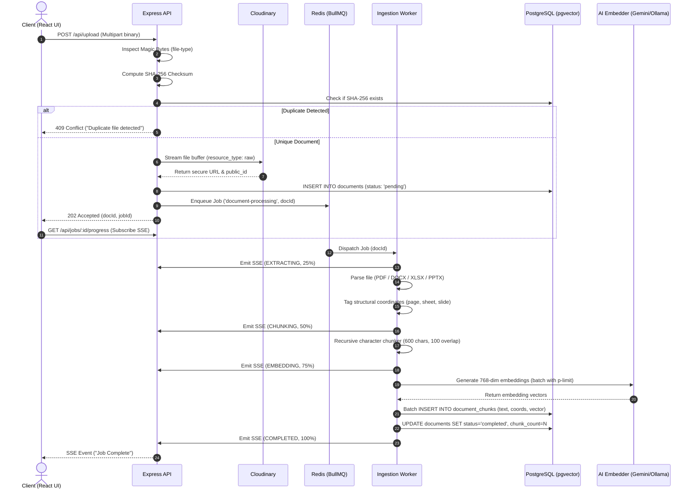
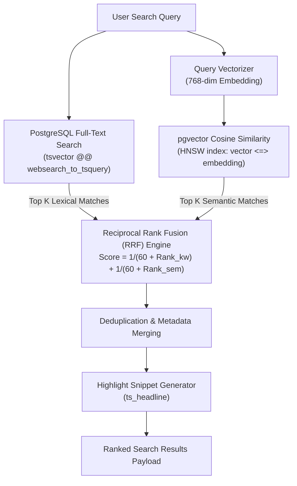
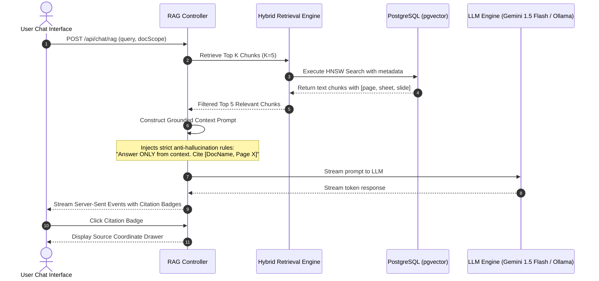

# System Architecture Specification — DocuMind

> **Status**: Production Architecture Blueprint  
> **Target Audience**: Systems Engineers, Architects, and Tech Leads

---

## 1. System Topology & Architectural Tiers

DocuMind is designed around a **modular, feature-based decoupled architecture** ensuring strict separation between synchronous HTTP user transactions, long-running asynchronous worker pipelines, persistent relational/vector storage, and external AI providers.

```
┌────────────────────────────────────────────────────────┐
│                   Frontend Client                      │
│     React 19 · TypeScript · Vite · Tailwind CSS        │
│          shadcn/ui · Zustand · TanStack Query          │
└───────────────────────────┬────────────────────────────┘
                            │ REST APIs & Server-Sent Events (SSE)
┌───────────────────────────▼────────────────────────────┐
│                  Express Backend API                   │
│   • Zod Input Validation & Security Middleware         │
│   • Multer Upload Controller (Memory Buffer)           │
│   • SHA-256 Deduplication Service                      │
│   • Cloudinary Streaming Service                       │
│   • BullMQ Queue Producer ('document-processing')      │
└─────────────┬──────────────────────────────┬───────────┘
              │ Enqueues job                 │ Reads/Writes metadata
┌─────────────▼─────────────┐   ┌────────────▼───────────┐
│     Redis (BullMQ)        │   │  PostgreSQL (pgvector) │
└─────────────┬─────────────┘   │  • documents           │
              │ Job dispatch    │  • document_chunks     │
┌─────────────▼─────────────┐   │    (vector embeddings) │
│   BullMQ Worker Process   │   │  • processing_jobs     │
│  • Multi-Format Parsers   │───┤  • categories & tags   │
│    (PDF, DOCX, XLSX, PPTX)│   └────────────────────────┘
│  • Recursive Chunker      │
│  • Pluggable AI Embedder  │
│    (Ollama / Gemini)      │
└───────────────────────────┘
```

---

## 2. Document Ingestion Pipeline

### Sequence Flow: Upload to Vector Storage


---

## 3. Intelligent Search & Retrieval Architecture

DocuMind avoids single-method retrieval by executing a **parallel hybrid retrieval pipeline** fusing full-text lexical ranking with high-dimensional vector similarity.



### Reciprocal Rank Fusion (RRF) Implementation
When combining ranking lists from heterogeneous scoring scales (lexical BM25/`ts_rank` scores are unbound, while cosine distances are in $[0, 2]$), normal score addition leads to bias. RRF normalizes using pure rank positions:
$$RRF\_Score(d \in D) = \sum_{m \in M} \frac{1}{k + r_m(d)}$$
* $k = 60$ (smoothing constant preventing high-rank dominance)
* $r_m(d)$ is the 1-based rank of document chunk $d$ in retrieval system $m$.

---

## 4. Grounded RAG Assistant Architecture



---

## 5. Pluggable AI Engine Architecture

To guarantee flexibility and zero lock-in, DocuMind defines a clean provider interface:

```typescript
export interface EmbeddingProvider {
  dimensions: number; // Standardized to 768
  generateEmbedding(text: string): Promise<number[]>;
  generateBatchEmbeddings(texts: string[]): Promise<number[][]>;
}

export interface ChatProvider {
  generateGroundedResponse(
    query: string,
    contextChunks: DocumentChunk[],
    history: ChatMessage[]
  ): AsyncIterable<string>;
}
```

* **Local AI**: `OllamaEmbeddingAdapter` connects to local Ollama daemon (`localhost:11434`) using `nomic-embed-text`.
* **Cloud AI**: `GeminiEmbeddingAdapter` connects to Google Cloud Vertex/Gemini API using `text-embedding-004`.
* Both output **768 dimensions**, requiring **zero PostgreSQL schema changes** when switching providers via the Settings UI.
